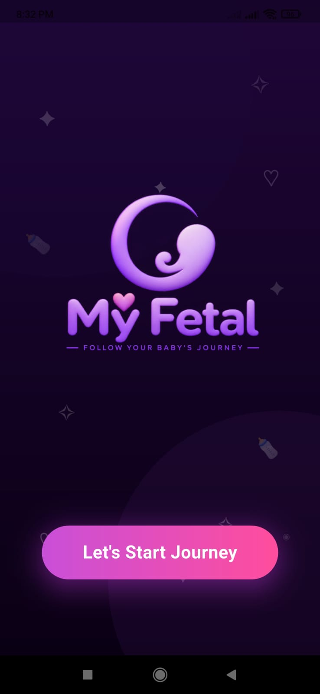
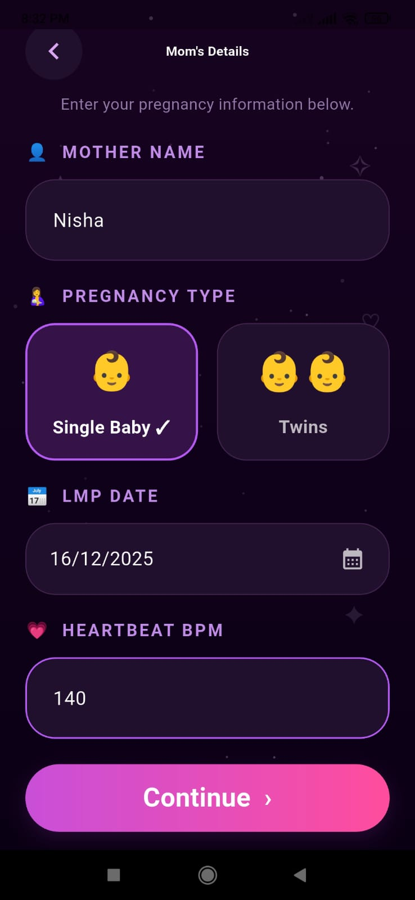
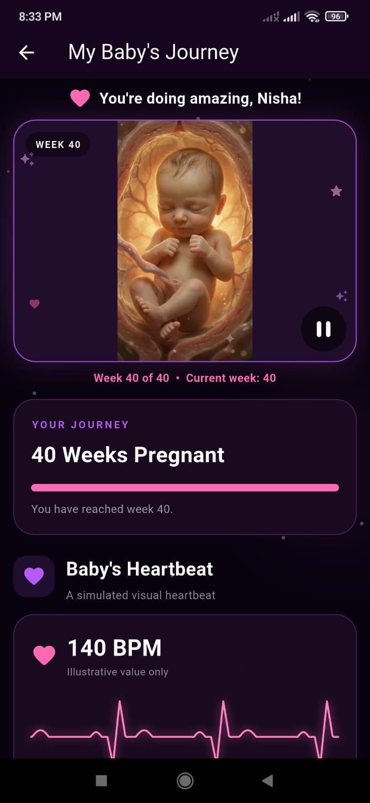

# 💜 MY FETAL – Your Pregnancy Journey

**MY FETAL** is a Flutter-based pregnancy journey application designed to help users explore illustrative baby development videos throughout pregnancy.

The app supports both single-baby and twin pregnancy journeys, with pregnancy-week estimation based on the Last Menstrual Period (LMP) date.

## ✨ Features

- **Splash Screen** – Welcome screen with a pregnancy-themed design.
- **Personal Details** – Enter mother's name, LMP date, pregnancy type and BPM value.
- **Single & Twins Support** – Choose between a single-baby or twin journey.
- **Pregnancy Week Estimation** – Estimates the current pregnancy week using the entered LMP date.
- **Baby Development Videos** – Illustrative videos across five pregnancy stages, from Week 1 to Week 40.
- **Weekly Timeline** – Explore the pregnancy journey by week.
- **Video Controls** – Play and pause baby development videos.
- **Pregnancy Milestones** – View trimester milestones.
- **Heartbeat Display** – Animated ECG visual with an illustrative BPM value.
- **Local Data Storage** – Saves entered details on the device.
- **About Section** – Information about MY FETAL and Ashick Labs.

## 🎬 Baby Development Video Stages

| Pregnancy Stage | Single Baby | Twins |
|---|---|---|
| Weeks 01–04 | Available | Available |
| Weeks 05–14 | Available | Available |
| Weeks 15–24 | Available | Available |
| Weeks 25–32 | Available | Available |
| Weeks 33–40 | Available | Available |

## 🛠️ Technologies Used

- Flutter
- Dart
- Material Design 3
- `video_player`
- `shared_preferences`
- `url_launcher`
- `flutter_launcher_icons`

## 📁 Project Assets

```text
assets/
├── images/
│   ├── logo.png
│   ├── logo_transparent.png
│   └── ashick_lab_logo.png
│
└── videos/
    ├── single_01_04.mp4
    ├── single_05_14.mp4
    ├── single_15_24.mp4
    ├── single_25_32.mp4
    ├── single_33_40.mp4
    ├── twins_01_04.mp4
    ├── twins_05_14.mp4
    ├── twins_15_24.mp4
    ├── twins_25_32.mp4
    └── twins_33_40.mp4
```

## 🚀 Getting Started

### Prerequisites

- Flutter SDK
- Dart SDK
- Android Studio or Visual Studio Code

### Installation

1. Clone the repository:

```bash
git clone https://github.com/Ashick3200/my-fetal-app.git
```

2. Open the project folder:

```bash
cd my-fetal-app
```

3. Install dependencies:

```bash
flutter pub get
```

4. Run the application:

```bash
flutter run
```

### Build APK
flutter build apk --release

## 📱 App Screenshots

### Splash Screen


### Data Entry Screen


### Baby Development Screen



## ⚠️ Medical Disclaimer

MY FETAL is an educational application. Baby development videos are illustrative and do not represent the actual baby in real time. The displayed BPM value and ECG animation are illustrative only and are not actual heartbeat measurements.

This application does not provide medical diagnosis or replace professional medical advice or care.

## 👨‍💻 Developer

**Ashick Labs**

Email: ashicklabs@gmail.com

## 📌 Project Information

- Application: MY FETAL
- Version: 1.0.0
- Platform: Flutter
- Repository: [MY FETAL on GitHub](https://github.com/Ashick3200/my-fetal-app)

---

**MY FETAL – Explore Every Stage of the Journey 💜**
